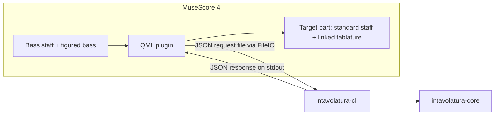

# Intavolatura for MuseScore

A MuseScore 4 plugin that realizes figured bass into a fretted part: the user writes a bass line with MuseScore's own figured bass, selects it, and the plugin writes a fingering for every chord into a tablature staff and its linked standard staff. The realization is the one the standalone app makes: same chords, same candidate fingerings, same ranking, same instruments.

Vocabulary is that of the app, defined in [../intavolatura/CONTEXT.md](../intavolatura/CONTEXT.md). MuseScore's "string" is our **course**; its standard staff linked to the tablature plays the role of the **voicing staff**. Pitches are in scientific pitch notation (C4 = middle C) everywhere.

## Scope

The plugin owns only what MuseScore lacks: chord derivation from bass note and figuring, the fingering search and ranking, and per-instrument rules. MuseScore keeps everything else: note and figure entry, rhythm, bar lines, keys, time signatures, playback, layout and PDF. No port of the app's editor, settings window, synthesizer or PDF writer.

## Architecture



- **`intavolatura-core`** (in the `intavolatura` workspace) stays the single source of truth. No serde or MuseScore knowledge in it.
- **`intavolatura-cli`**: a new crate in the `intavolatura` workspace. Reads one JSON request, writes one JSON response; all JSON lives here. Stateless.
- **QML plugin** (this repo): reads the selection, writes the request, runs the CLI through `QProcess`, writes the result into the score. No music logic of its own.
- **This repo** holds the plugin, packaging (build the CLI, copy the binary next to the plugin) and docs. A change that needs the core lands in `intavolatura` first.

## Decisions

1. **Narrow realize command.** Not a full port and not a bridge to the app.
2. **The Rust core decides; the plugin is thin.** Called as a CLI through `QProcess`. A JS port was rejected: two implementations of ranking would drift while the weights are still being tuned. WASM is not available in QML's JS engine.
3. **Input is MuseScore's native figured bass.** Confirmed by the spike: each figured bass item is a segment annotation (`Element.FIGURED_BASS`) with a readable `text` and tick. Its text is parsed with the core's figuring parser after mapping MuseScore's spelling (see Spike findings). Its duration is not exposed, so a figure lasts until the next figure or the end of its bass note.
4. **The user prepares the target part.** A plucked-string part with a standard staff and a linked tablature staff, tuned and given its tablature style (French or Italian) in MuseScore. The plugin writes pitch plus `string` and `fret` for every note; both staves follow from those notes. The plugin does not create parts (stock instruments only, tuning not settable from a plugin).
5. **The staff defines the tuning.** The plugin reads the target staff's string data (open pitch per string and the `open` flag) and sends it to the core as the instrument's courses; open-only strings are diapasons. A **rule preset** (theorbo, Renaissance lute, archlute, baroque lute, baroque guitar) supplies what tuning alone does not: fret counts per course, register and ranking rules (e.g. the guitar's full strummed chords, re-entrant bass rules). The preset defaults to a guess from string count and tuning. Retuning diapasons to the key is the user's job in MuseScore's string data; the plugin has no such setting. What is in the score is what is realized.
6. **Mode from the run dialog.** The API gives only the key signature's number of accidentals. The dialog offers major or minor for the whole selection, preselected by the selection's last bass note: the major key's tonic → major, the relative minor's tonic → minor, otherwise major. Key signature changes inside the selection keep the chosen mode; a different mode means a separate run.
7. **Realize plus stateless cycling.**
   - *Realize selection* writes the top-ranked candidate for every bass note. Option: *keep chords that already have a fingering*, so a re-run keeps earlier choices.
   - *Next fingering* / *Previous fingering* act on the chord at the selection in the target staff: read its strings and frets, ask the core for the candidates of that bass note and figuring, find the current fingering among the top N and write the neighbour. A fingering not among the top N steps to the best candidate.
   - The pinned fingering is simply what is in the score; nothing is stored on the side. As in the app, a pin no longer applies once the bass note or figuring changes (it is not a candidate of the new chord) and the next realize or cycle replaces it.
   - Shortcuts: MuseScore registers every plugin `.qml` file as one action, *Run plugin <title>*, which can get a shortcut in Preferences → Shortcuts. So *Realize selection*, *Next fingering* and *Previous fingering* are three `.qml` files in one plugin folder.
8. **CLI crate in the `intavolatura` workspace.** Core changes and the CLI are tested together with the existing tests and benches.
9. **Suspensions: one fingering, held voices tied.** Figured bass items under one bass note with different ticks form a suspension (uneven splits follow from the ticks). The core finds one fingering for the whole suspension. The plugin writes the first chord at the first figure's tick, and at each later figure's tick a chord in which held voices are tied from the previous one and only the resolving voices are new notes. How the tablature shows tied notes is the staff's own setting.
10. **The bass line is the selected staff.** For each moment the bass note is the lowest sounding note across all voices of the selected staff; tied notes are joined into one bass note; rests stay rests. Durations are copied, so bar lines, upbeats, meter changes, triplets and notes across bar lines are MuseScore's business. The target staff is chosen in the run dialog from the score's tablature staves, defaulting to the first one below the selection.
11. **No playable fingering → rest, label, report.** The target gets a rest of the bass note's duration with a staff text "no fingering"; the run continues. At the end a summary lists the bar, the figures and the reason for every failure (also unreadable figurings). The whole run is one undo step.
12. **MuseScore 4 only, minimum 4.7.5.** The only version the spike ran on; earlier 4.x releases are untested and not supported.

Defaults:
- Run dialog: target staff, instrument rules (preset), mode, fret span (2–6, default 4), fingerings to cycle (1–50, default 10), keep chords that already have a fingering (default on). Fret span, fingerings to cycle and keep are remembered between runs with MuseScore's plugin `Settings` (not a file of our own: MuseScore persists them, and there is no temp-file pitfall).
- Each realize stores its settings (bass staff, tablature staff, mode, preset, fret span, fingerings to cycle) in the score as the meta tag `intavolatura`. *Next* / *Previous fingering* need them (the bass staff and the mode cannot be read from a selected chord), and the dialog starts from them when the same bass staff is realized again, else from the first tablature staff below and the guesses. Pins are still only the notes in the score.
- No playback work: MuseScore plays the target staff.

## CLI contract

`intavolatura-cli <request.json>` (crate `crates/intavolatura-cli` in `intavolatura`; types documented in its `src/lib.rs`). The plugin writes the request as a JSON file in the temp directory; the CLI answers with JSON on stdout, which the plugin reads with `readAllStandardOutput()`. Every MuseScore convention ends in the CLI, so the plugin passes what MuseScore gives it unchanged: string numbers (0 = course 1), MIDI pitches, tonal pitch classes (`tpc`), figured bass text, the string list lowest first. Rhythm stays in the plugin: the CLI never sees ticks or durations.

```json
{
  "command": "realize",            // or "next", "previous"
  "key": { "signature": -1, "mode": "minor" },
  "instrument": {
    "preset": "theorbo-a-14",      // a core instrument id: its rules apply
    "strings": [ { "pitch": 31, "open": true }, …, { "pitch": 57 } ],  // as StringData lists them
    "frets": 13
  },
  "settings": { "fretSpan": 4, "candidates": 10 },   // optional; these are the defaults
  "notes": [
    { "id": 0, "pitch": 50, "tpc": 16,
      "figures": ["4", "3"],      // one text per figured bass item, in order; none = 5/3
      "fingering": [ { "string": 4, "fret": 0 }, … ] }   // optional: the chord in the score
  ]
}
```

- `realize` keeps a note's `fingering` where it is valid for the chord, else writes the best candidate. `next` / `previous` step from it through the best `candidates`, wrapping; a fingering that is not among them steps to the best.
- **Response**: `{ "notes": [ … ] }` with, per note, either `{ "id", "parts": [ { "notes": [ { "string", "fret", "pitch", "tpc", "struck" } ] } ] }` (one part per figured bass item, notes lowest first, `struck: false` for a voice held from the part before, to be tied), or `{ "id", "error" }` for an unreadable figuring or no playable fingering. A request that cannot be read at all gives `{ "error" }` (and exit code 1 when the file is missing).
- Strings carry no spelling; the CLI spells them near the key (D minor: C#, Bb). Figures are mapped to the core's syntax: lines become spaces, items dashes, `h` a natural, `6/` a raised 6; brackets are dropped.
- Golden request/response pairs in `crates/intavolatura-cli/tests/golden/` cover plain chords, suspensions (6/4–5/#, 4–3, 7–6), keeping a fingering, next/previous, an unplayable note, unreadable figures and an unknown preset. After a ranking change, regenerate with `BLESS=1 cargo test -p intavolatura-cli` and review the diff.

## Roadmap

Each step is buildable and tested before the next starts.

1. [x] **Spike** (MuseScore 4.7.5, macOS; the throwaway probe plugin is removed, its headless runner lives on as `test/run.sh`). A plugin runs headless through MuseScore's converter: `mscore -o out.mscz --extension musescore://extensions/v1/<folder>/<file>.qml in.mscz`. Outcome:
   1. Figured bass: **go**. Text, tick and track are readable; figures in the middle of a bass note (suspensions, uneven splits like 7:4.–6:8) sit on segments of their own at the right tick.
   2. String and fret: **go**. A plugin may set `string` and `fret` on notes it added, on the standard staff or on the tablature; both linked staves keep them after `endCmd()`, provided the pair sounds the note's pitch. An invalid pair is silently replaced by MuseScore's own fretting.
   3. Theorbo string data: **go**. The stock `theorbo-14-course` lists strings lowest first with `open: true` on the eight diapasons; re-entrant courses come out in course order (… A2 D3 G3 B3 E3 A3). One `frets` value for the whole instrument. Diapasons are written as open strings (fret 0) and drawn by MuseScore below the French staff; whether its diapason signs match the sources is a visual check for step 4.
   4. External process: **go on macOS**, Windows and Linux untested. `QProcess` runs the binary and its stdout is readable; `FileIO` writes the request. Two pitfalls (see Spike findings). An unsigned binary carrying the quarantine flag (downloaded) is killed by Gatekeeper; one built locally runs.
   5. Ties and staff text: **go**. Undo as one step: **go**, checked in the GUI: one Cmd+Z removes everything a run wrote (`startCmd()` locks the undo stack until `endCmd()`, `cmd()` calls included). `cmd("undo")` has no effect in headless runs.
   6. Shortcuts: **go**, checked in the GUI: *Run plugin <title>* can be given a shortcut in Preferences → Shortcuts (see decision 7).
2. [x] **Core changes** (`intavolatura`): `Instrument::restrung` gives a preset's rules (id, ranking, strumming) another stringing, course 1 first, each course's open pitch and whether it is open-only; a fretted course keeps the preset's fret count for that course, else takes the staff's. `Realization::neighbour` steps from a given fingering to the next or previous candidate, wrapping; a fingering that is not a candidate steps to the best (`cycle` now builds on it). Tests in `instrument.rs` and `realization.rs`.
3. [x] **CLI crate** (`intavolatura-cli`): the contract above, `realize`, `next` and `previous`; golden tests. Core additions for it: `Key::from_signature`, `NoteName::from_fifths`, `Pitch::spelled`.
4. [x] **Plugin: realize** (`plugin/intavolatura/realize.qml`, logic in `intavolatura.js`): dialog with tablature staff, instrument rules (the CLI's `presets`, best match first), mode (guessed), fret span, fingerings to cycle, keep; then the bass line reduction, one CLI request per key signature, and one undo step that clears the target range (tuplets and old labels included) and writes chords, rests, ties for held voices and split durations, tuplets where the bass has them, and "no fingering" labels; a summary lists failures by bar.
5. [x] **Plugin: cycling** (`next.qml`, `previous.qml`): replace the bass note at the selection (a note of the realization, of the bass, or a range start) with the next or previous candidate, whole suspension included, as one undo step; the new chord stays selected so the shortcut can be pressed again. The *keep* option of realize sends the chords in the score as fingerings to keep.
6. [x] **Packaging**: `scripts/install.sh [plugins-folder]` builds the CLI from `../intavolatura` (or `INTAVOLATURA_REPO`) and installs `realize.qml`, `next.qml`, `previous.qml`, `intavolatura.js` and `bin/intavolatura-cli` into MuseScore's plugins folder; `README.md` covers setup and use.

Tests: `test/run.sh` builds the CLI and a test score (`test/fixture.intav` exported to MusicXML, a second voice added in the last bar, an empty theorbo part added), installs the plugin and a harness plugin (`test/harness/`), and runs the runs in `test/options.json` headless: realize, next on a plain chord and on a 4–3 suspension, realize again keeping those, previous twice (wrapping). It prints a report of the tablature staff after every run (`python3 test/show.py` summarizes it) and leaves `/tmp/intavolatura-test/out.mscz` and `out-1.png`. The dialogs themselves only run in the GUI; the harness checks that they compile.

## Spike findings

Constraints the plugin must follow, all from MuseScore 4.7.5:

- **Figure spelling**: figures are separated by newlines (`"6\n4\n3"`); a sharp is `#`, a flat `b`, a natural `h` (`"h3"`), a raised figure `6/` (also `6\` and `6+` when typed in MuseScore). The CLI maps these to the core's syntax.
- **Course numbers**: `note.string` counts from the top course: 0 = course 1. On the theorbo, 0–5 are the fretted courses and 6–13 the diapasons (course = string + 1).
- **Entering chords**: `Cursor.rewindToTick` only lands on segments that exist in that track; over a whole-bar rest it jumps to the next bar. The writer clears the range first (a range delete leaves rests from its start) and enters chords and rests in order from there, as note input does.
- **Selections**: `Selection.selectRange` cannot reach the end of the score (its end snaps to the last segment), and after a delete the selection's segments may be gone: read `endSegment.tick` before deleting. A range delete keeps tuplets (filled with rests) and staff texts; the plugin removes its own.
- **Cursor key signature**: `Cursor.keySignature` crashes MuseScore when the cursor has run past the last element of its track; read it where the bass note's chord starts.
- **Ties**: select the held notes of the first chord (`selection.select(note, true)`) and run `cmd("tie")`; it ties them to the same pitches in the next chord without adding notes. `newElement(Element.TIE)` added to a note crashes MuseScore.
- **Processes**: declare `QProcess { id: … }` in QML and call `startWithArgs`; `newQProcess()` fails with "Unknown method return type".
- **Temp files**: `FileIO.write` refuses to overwrite an existing file in the temp directory on macOS (`$TMPDIR` resolves through `/private/var`, which its allow-list does not contain). Remove the file first (`remove()` is not restricted) or use a new name per run. Writes outside the user's MuseScore folders and the temp directory are refused.
- **Undo**: `curScore.startCmd("Realize figured bass")` names the undo entry.

## Risks

- MuseScore draws the theorbo's diapason signs itself; if they do not match the sources, that is MuseScore's tablature, not the plugin's.
- Windows and Linux: `QProcess` and the temp-directory rules are untested there.
- A CLI binary downloaded rather than built locally is killed by Gatekeeper unless signed and notarized or its quarantine flag is removed; packaging builds it from source.
- The plugin API changes between 4.x releases; the minimum version is stated and checked on each release used.
